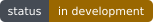
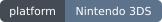
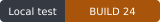
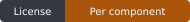

<h1 align="center">Super Mario 64 DS 3DS</h1>

<p align="center">
  <strong>Return to the castle. Take both screens with you.</strong><br>
  A native Super Mario 64 DS port in development for Nintendo 3DS.
</p>

<p align="center">
  <a href="#source-and-installation">Source</a> ·
  <a href="#features">Features</a> ·
  <a href="#documentation">Documentation</a> ·
  <a href="CHANGELOG.md">Changelog</a> ·
  <a href="CONTRIBUTING.md">Contribute</a> ·
  <a href="#community-and-bug-reports">Community</a>
</p>

<p align="center">
  <a href="docs/COMPATIBILITY.md"></a>
  <a href="docs/COMPATIBILITY.md"></a>
  <a href="docs/STATUS.md"></a>
  <a href="LICENSE.md"></a>
</p>

<p align="center">
  <a href="https://estebanpdn.github.io/"></a>
  <a href="https://discord.gg/BjbzfRYpV"></a>
</p>

A native Nintendo 3DS adaptation of **Super Mario 64 DS**, based on
[Sébastien Breton’s native port](https://github.com/SebastienBreton/sm64ds-3ds)
and [Tango’s decompilation](https://github.com/tangosdev/sm64ds-decomp), with
analog movement, a touch interface and configurable camera and presentation.

This project was developed with the help of [OpenAI Codex](https://openai.com/codex/). Learn more about the development process [here](AI_DEVELOPMENT.md).

**In active development; source available, with no public binary release yet.**
See [Compatibility](docs/COMPATIBILITY.md) for BUILD 24 test coverage and
remaining Old/New 3DS hardware qualification.

## Features

<table>
  <tr>
    <td width="50%" valign="top"><strong>Explore with analog controls</strong><br>Circle Pad movement, touch controls and a free C-stick camera on compatible systems. Configurable movement modes.</td>
    <td width="50%" valign="top"><strong>Made for two screens</strong><br>Native upper-screen 3D, stereoscopic presentation and dedicated lower-screen pause and options menus.</td>
  </tr>
  <tr>
    <td width="50%" valign="top"><strong>Prepare once, load directly</strong><br>A single .sm64ds companion, prepared locally from your compatible European ROM and read directly from SD.</td>
    <td width="50%" valign="top"><strong>Keep settings and track problems</strong><br>Persistent options, audio controls, backup recovery and a visible BUILD number for reproducible bug reports.</td>
  </tr>
</table>

The original simulation and visual presentation use separate clocks. The
optional 60 Hz presentation path interpolates eligible frames; it is not a
claim of sustained 60 FPS on either console model. See
[compatibility and evidence](docs/COMPATIBILITY.md).

## Source and installation

The current source is available here; **there are no releases or binary
downloads yet**. Build instructions and required private inputs are in the
[build guide](docs/BUILDING.md).

A compatible user-supplied **European ASMP revision 0 Nintendo DS ROM** is
required. No ROM, prepared gameplay archive, firmware, save or raw memory dump
is included. For a locally built CIA or 3DSX:

1. Install the CIA with FBI, or launch the 3DSX through Homebrew Launcher.
2. Put your compatible `.nds` ROM in `SD:/3ds/sm64ds/`, or copy a matching
   `.sm64ds` companion made with [SM64DS Packer](docs/SM64DS_PACKER.md).
3. Launch the port and let preparation complete. Preserve existing saves and
   settings when replacing a test build.
4. In the original interactive introduction, touch the **star itself** to
   continue. The BUILD label appears at the lower left of the title, pause
   menu and options.

See [SD data and recovery](docs/SD-DATA.md) before moving files or replacing
an older build. The integrated game and the historical model viewer have
different inputs and application IDs; use the integrated ROM-only target.

## Controls

| Input | Current use |
| --- | --- |
| Circle Pad | Analog movement; configurable sensitivity and run threshold. |
| A / B / X / Y, L / R | Game actions according to the selected controller and movement mode. |
| C-stick | Configurable camera on compatible New systems. |
| START | Open the in-game pause menu. |
| Touch screen | Original interactions, pause, controller and options menus. |
| 3D slider | Stereoscopic presentation where supported by the display path. |

Developer capture shortcuts and their disk-space implications are described
in [diagnostics](docs/DIAGNOSTICS.md).

## Documentation

| Guide | Purpose |
| --- | --- |
| [Documentation index](docs/README.md) | Current guides and historical investigations. |
| [Compatibility](docs/COMPATIBILITY.md) | Supported input, model profiles and validation limits. |
| [SD data](docs/SD-DATA.md) | ROM, companion, saves, settings and recovery. |
| [Building](docs/BUILDING.md) | Source pins, SDK, private inputs and packaging. |
| [Architecture](docs/ARCHITECTURE.md) | Startup, ownership, adapters, workers and caches. |
| [Testing](docs/TESTING.md) | ROM-free checks, ARM gates and emulator/hardware evidence. |
| [Repository map](docs/REPOSITORY.md) | File placement and maintenance conventions. |
| [Source provenance](docs/UPSTREAM.md) | Dependencies, immutable pins and notices. |
| [Roadmap](docs/ROADMAP.md) | Remaining acceptance work. |

## Development

Requirements for portable checks: Git, Python 3.11+, CMake 3.20+ and a C++17
compiler. Clone with the public motion-library submodule:

<details>
<summary><strong>Clone and run the portable checks</strong></summary>

```sh
git clone --recurse-submodules https://github.com/EstebanPdN/sm64ds-3ds.git
cd sm64ds-3ds
python3 scripts/check-repository.py
cmake -S . -B build/host -DCMAKE_BUILD_TYPE=Debug
cmake --build build/host --parallel 4
ctest --test-dir build/host --output-on-failure
```

</details>

The complete game additionally requires devkitPro/devkitARM, libctru,
Citro3D, the pinned Python packages and the local inputs listed in
[Building](docs/BUILDING.md). A clean source checkout does not contain
those game inputs. [Contributing](CONTRIBUTING.md) explains the checks and
compatibility contracts to preserve.

## Community and bug reports

[Join Discord](https://discord.gg/BjbzfRYpV) for discussion and testing.
Use [GitHub issues](https://github.com/EstebanPdN/sm64ds-3ds/issues) for
reproducible bugs, including the visible BUILD number, console model and
steps to reproduce. Review logs and captures before sharing them; full
process dumps and game data must remain private.

## Credits

- Sébastien Breton and SM64DS 3DS contributors — the integrated native backend.
- Tango and sm64ds-decomp contributors — reconstruction, data formats and decoders.
- libsm64 and mkst/sm64-port contributors — the optional movement solver and reference logic.
- devkitPro, libctru and Citro3D contributors — Nintendo 3DS development tools and libraries.
- Nintendo — Super Mario 64 DS and original game content.
- EstebanPdN — adaptation, interface, diagnostics and maintenance, with help from Codex.

See the [full credits](docs/legal/CREDITS.md) and
[third-party notices](docs/legal/THIRD_PARTY_NOTICES.md).

## License and legal notice

Licenses are component-specific. The native provider and NTR decoders retain
their MIT notices; libsm64 retains its CC0 text. Other dependencies retain
their own terms. [LICENSE.md](LICENSE.md) explains the scope; no blanket
license is assigned to Nintendo content or to every file in this repository.

This is an unofficial fan project, unaffiliated with Nintendo. Screenshots
and approved interface/packaging artwork depict Nintendo-owned content and
do not grant rights to the game or its trademarks.

---

<p align="center">
  <a href="https://estebanpdn.github.io/">Esteban’s Forge</a> ·
  <a href="https://discord.gg/BjbzfRYpV">Discord</a> ·
  <a href="docs/README.md">Documentation</a> ·
  <a href="docs/legal/CREDITS.md">Credits</a> ·
  <a href="docs/legal/THIRD_PARTY_NOTICES.md">Third-party notices</a><br>
  <sub>Super Mario 64 DS belongs to Nintendo. This is an independent fan project.</sub>
</p>
