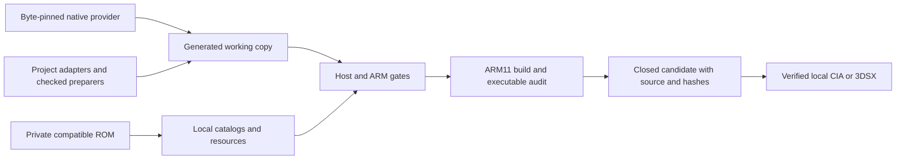

# Architecture

The maintained executable combines a pinned native SM64DS backend with
project-owned preparation scripts and adapters. It is a native ARM11/PICA200
application; it does not run a DS emulator. The historical viewer/runtime
under `source/ctr/` and `source/game_port/` is a separate development path.

## Build flow

`tools/build_integrated_native.py` owns orchestration. It verifies source
pins, reserves a BUILD number, snapshots inputs, runs gates and freezes the
result. `tools/prepare_integrated_*.py` validate known source contracts before
editing the generated copy. Packaging consumes a closed candidate and checks
its executable identity; it does not rebuild or publish it.

## Startup and runtime

The generated `game_entry.cpp` initializes the frontend, applies settings,
selects a valid companion or prepares it from the user's ROM, and enters the
native backend. Boot-time containers use the system allocator: the global
C++ allocator belongs to the retail game heap and is unavailable until that
heap is initialized. BUILD 24 removes a missing-settings fallback allocation
that violated this ordering.

The original game advances its simulation at its existing 30 Hz cadence.
`render_60.hpp` and presentation hooks can insert eligible visual midpoints
without advancing game logic twice. Pauses, menus and held frames have their
own invalidation rules. A displayed frame rate is not proof of physical
timing on every console model.

## Ownership boundaries

| Component | Owns and preserves |
| --- | --- |
| `rom_setup_3ds.hpp`, `rom_bootstrap.hpp`, `packed_builder.hpp` | Bounded ROM validation/preparation, cancellation and companion publication. |
| `packed_assets*.hpp` | Companion member index and shared read access; member offsets replace thousands of SD files. |
| `options/enhance_settings.*`, `atomic_file.hpp` | Validated settings and backup-first replacement without early retail allocations. |
| `options/native_pause_*`, `native_lower_*` | Menu model, touch actions and cached lower-screen images. |
| `options/overlay_publication.hpp` | Producer/consumer generations; hiding an image does not release a slot still read by a worker. |
| `options/cstick_camera.*`, `native_gameplay_camera.hpp` | Camera input, dead zones and original-game handoff. |
| `movement/native_motion.cpp`, `world_session.hpp` | Actor/session lifetime, input history, solver continuity and DS handoffs. |
| `options/audio_gain.hpp`, `audio_diagnostics.hpp` | Stereo gain ramp and opt-in counters; original mixer/NDSP retain PCM/queue ownership. |
| `options/console_profile.*`, `level_files.hpp` | Model-aware budgets and level prefetch policy. |
| `native_diagnostics.hpp`, `options/diagnostic_*`, `dump_*` | Private runtime captures, counters and diagnostic presentation. |

The backend owns actor logic, source resources, GPU rendering and audio
services; local hooks adapt the boundary. N64 movement is optional and must
yield for unsupported actor states, abilities, damage, water and scripted
actions. Switching profiles must not erase an owned solver's jump history.

## Threads, caches and teardown

Console profiles select available worker cores and cache/preload budgets.
The presentation consumer and game producer exchange completed images using
the publication protocol. Shutdown joins workers before releasing resources
they can still reference. GPU fences and cache maintenance remain part of
correctness, even when profiling identifies their cost.

Level file lists can be prefetched into bounded RAM; shared companion reads
avoid repeatedly opening the same SD file. Mesh/material/uniform caches and
2D UI caches reduce repeated work, with invalidation tied to their actual
inputs. Changes to cache keys, routing or render order require differential
checks, not only an FPS comparison.

The diagnostic capture settles presentation work, records displayed buffers
and exports readable mappings and VRAM. GPU, DSP and operating-system state
are not an atomic whole-machine snapshot. See [Diagnostics](DIAGNOSTICS.md)
and the detailed [adapter contracts](DEVELOPMENT.md).
